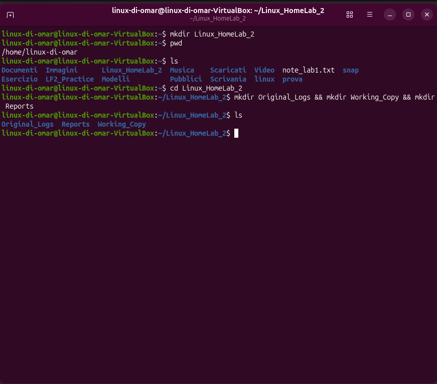
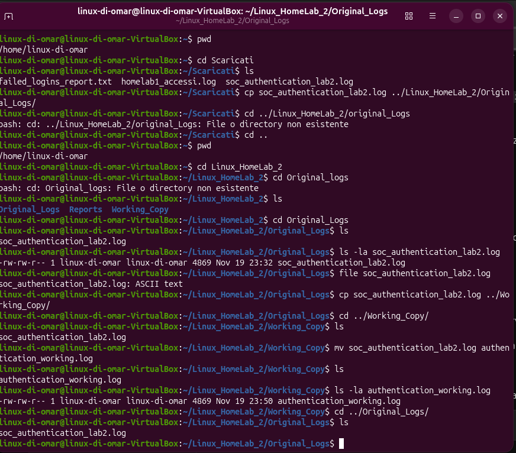
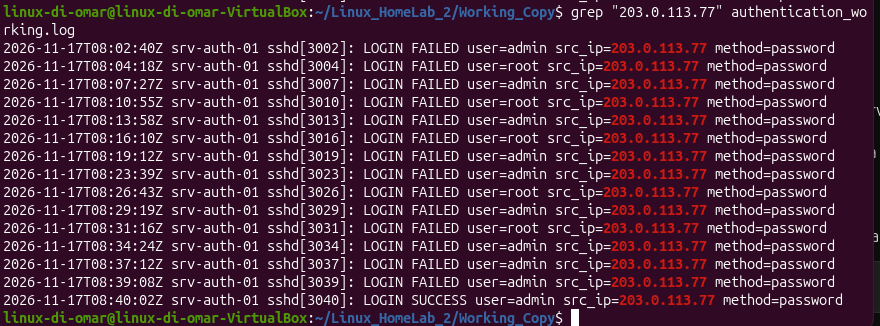
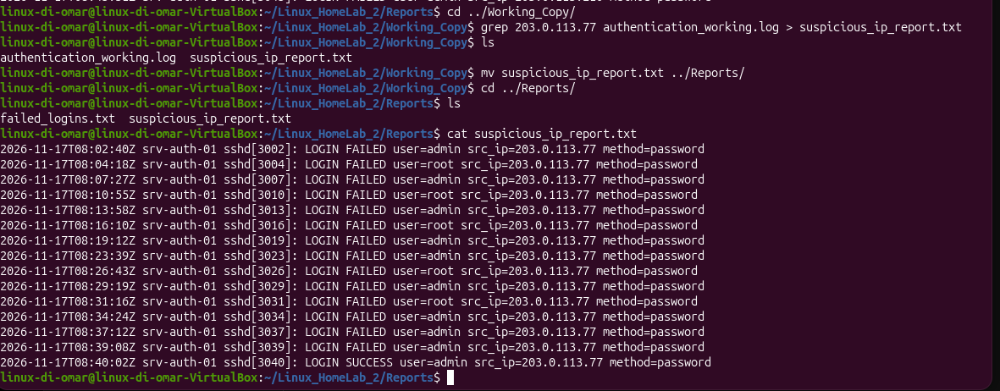

# Linux Fundamentals Part 2 – SSH Security Investigation & Evidence Management

## Project Overview

This project is the second stage of my hands-on Linux and cybersecurity learning journey.

The objective was to investigate simulated SSH authentication events on a Linux server, identify suspicious activity, preserve the original log, and document the findings.

The lab was completed using Ubuntu Linux in a VirtualBox environment.

**Learning level:** Beginner / Intermediate  
**Focus:** Linux Fundamentals, File Management, Log Analysis, and Blue Team Fundamentals

## Scenario

As a junior SOC analyst, I was tasked with investigating potentially suspicious authentication activity on a simulated Linux server named `srv-auth-01`.

The investigation involved reviewing authentication logs, identifying repeated failed login attempts, and determining whether any suspicious source IP addresses had successfully authenticated.

## Tools and Linux Commands

The following commands and operators were practiced during the lab:

| Command | Purpose |
|---|---|
| `pwd`, `cd`, `ls`, `ls -la` | Filesystem navigation and file inspection |
| `mkdir`, `touch` | File and directory management |
| `cp`, `mv` | Copying, moving, and organizing evidence |
| `cat` | Reading authentication logs and reports |
| `grep` | Filtering authentication events |
| `find` | Locating files |
| `file` | Identifying file types |
| `rm`, `rm -R` | Removing unnecessary practice files and directories |
| `man` | Consulting Linux command documentation |
| `>` and `&&` | Output redirection and command chaining |

File deletion was practiced on unrelated training files, not on the investigation evidence.

## Investigation Process

### 1. Environment Preparation

I created a dedicated directory structure to separate the original authentication log, the working copy, and the investigation reports.

### 2. Evidence Preservation

I copied the provided simulated authentication log into `Original_Logs` and created a separate working copy for analysis.

The original file was preserved without modification.

### 3. Authentication Log Analysis

I used Linux commands to investigate failed SSH authentication attempts and examine activity associated with specific source IP addresses.

One address, `203.0.113.77`, was particularly noteworthy because it appeared repeatedly in failed login events before a successful authentication.

### 4. Investigation Reports

I generated two technical reports:

- `failed_logins.txt` – contains failed authentication events.
- `suspicious_ip_report.txt` – contains authentication events associated with the priority IP address.

I also prepared `incident_summary.txt`, documenting the findings, security assessment, and recommended defensive actions.

## Key Findings

| Finding | Result |
|---|---|
| Server | `srv-auth-01` |
| Priority source IP | `203.0.113.77` |
| Failed logins from this IP | 14 |
| Successful logins from this IP | 1 |
| Accounts involved | `admin`, `root` |
| Successful account | `admin` |
| Authentication method | Password |

Another source IP, `203.0.113.210`, was associated with six failed attempts and no successful logins in the supplied dataset.

## Security Assessment

The repeated authentication failures followed by a successful password-based login from `203.0.113.77` could indicate a successful brute-force attack.

However, this is a hypothesis rather than a confirmed compromise.

Additional investigation would be required to determine whether the authentication was authorized and whether any suspicious actions occurred after the successful login.

## Challenges and Troubleshooting

During the lab, I encountered and corrected several command-line errors, particularly involving relative paths and file movement.

I also corrected an incorrectly structured `mv` command and practiced using Linux error messages to identify mistakes.

These challenges helped me improve my understanding of filesystem navigation, command syntax, and evidence organization.

## Learning Progression

This project builds on my first Linux Home Lab.

**Home Lab 1 – Foundation**

I practiced basic Linux commands and performed a simple analysis of simulated failed authentication events.

**Home Lab 2 – File Management and Security Investigation**

I expanded my skills by organizing an investigation workspace, preserving original evidence, using relative paths, filtering events by source IP, and producing structured investigation reports.

My next objective is to develop more advanced Linux defensive security skills, including process monitoring, service inspection, system logs, and network connection analysis.

## Repository Structure

- `Original_Logs/` – original simulated authentication log
- `Working_Copy/` – working copy used for the investigation
- `Reports/` – filtered events and incident summary
- `Screenshots/` – screenshots documenting the practical activities

## Lab Disclaimer

This project is based entirely on simulated SSH authentication logs.

The server information, authentication events, and IP addresses are fictional.

All documented terminal activities were performed in a controlled training environment.

The findings demonstrate foundational Linux and defensive security analysis skills, not a confirmed real-world security incident.
